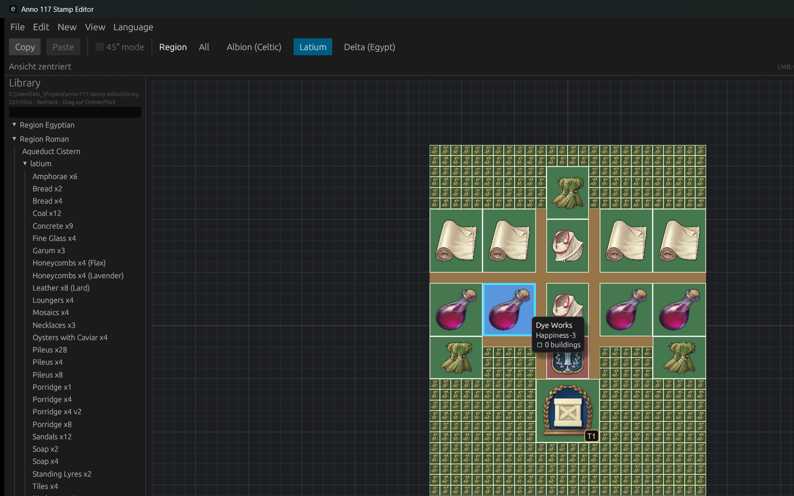
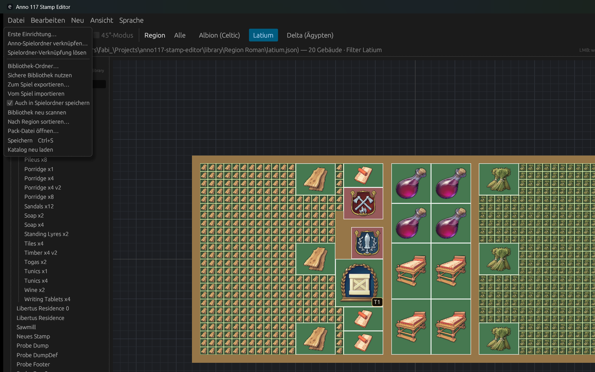

# Anno 117 Stamp Editor

Community-Tool (Rust / egui) zum **Öffnen, Bearbeiten und Speichern** von Anno-117-Stamp-Packs (Blueprints).

> **Kein offizielles Ubisoft-Produkt.** Anno 117, Marken, Spielassets und spielbezogene Inhalte gehören **Ubisoft** bzw. den Rechteinhabern. Der **Editor-Quellcode** in diesem Repo steht unter der **MIT-Lizenz** (siehe [`LICENSE`](LICENSE)) und darf entsprechend frei genutzt, verändert und weitergegeben werden. Details: [Rechtliches](#rechtliches--fair-play).

---

## Screenshots

### Erste Einrichtung (Setup)

Beim ersten Start (oder über **Datei → Erste Einrichtung…**) legst du drei Pfade fest: Spielinstallation (Icons), Spiel-Stamps und die sichere Editor-Bibliothek.


### Hauptfenster

Links die Bibliothek (Packs/Stamps), in der Mitte die Stamp-Canvas, rechts/unten Baulette und Analyse.



### Menü Datei

| Eintrag | Funktion |
|--------|----------|
| Erste Einrichtung… | Pfade erneut setzen (Spiel, Stamps, Bibliothek) |
| Anno-Spielordner verknüpfen… | Installation für Icons |
| Bibliothek-Ordner… | Sicheren Editor-Ordner wählen |
| Vom Spiel importieren / Zum Spiel exportieren… | Sync zwischen Bibliothek und Documents-Stamps |
| Auch in Spielordner speichern | Beim Speichern zusätzlich ins Spiel spiegeln |
| Pack-Datei öffnen… / Speichern | Einzelnes Pack laden / speichern |
| Katalog neu laden | `editor_catalog.json` neu einlesen |



---

## Was kann der Editor?

- Stamp-Packs (JSON + Pipette/FileDB) laden und speichern
- Gebäude platzieren, verschieben, drehen, kopieren
- Straßen & Aquädukte malen (inkl. Hochführung über Straßen)
- Farmen / Felder (SubTileGrid), Coverage, Produktionsketten
- Bibliothek außerhalb des Spiel-Sync-Ordners + Mirror ins Spiel
- Residenz-Stufen **T1–T4** im Editor sichtbar (Hinweis: das Spiel speichert in Blueprints oft nur die Basis-GUID)

---

## Schnellstart (Release-Binary)

1. Unter [Releases](https://github.com/Fabibassi/anno117-stamp-editor/releases) die Windows-ZIP laden
2. `stamp_editor.exe` starten — **kein Python, keine Extra-Runtime** (standalone)
3. Beim **ersten Start** öffnet sich die Einrichtung:
   - Anno-Spielordner (Installation mit `maindata\ui.rda`) — für Icons
   - Spiel-Stamps — oft schon `Documents\Anno 117 - Pax Romana\stamps` (wird erkannt, wenn vorhanden)
   - Editor-Bibliothek — sicherer Ordner **außerhalb** des Sync-Ordners
4. Später erneut: **Datei → Erste Einrichtung…**

Optional für volle Baulette: `editor_catalog.json` neben die EXE legen (oder unter `_gamedata\`). Ohne Katalog startet der Editor trotzdem.

### Windows SmartScreen („Windows hat den PC geschützt“)

Die Release-EXE ist derzeit **nicht codesigniert**. Windows Defender SmartScreen kennt neue/unsignierte Community-Tools oft noch nicht und zeigt den blauen Hinweis.

**So startest du trotzdem:**

1. Auf **Weitere Informationen** klicken  
2. Dann **Trotzdem ausführen**

Das ist bei unsigned Open-Source-Downloads üblich und **kein** Nachweis für Malware. Quellcode liegt öffentlich auf GitHub; wer will, baut selbst mit `cargo build --release`. Eine kostenpflichtige Codesignatur (OV-Zertifikat) kann die Warnung mit der Zeit abmildern — sie ist für dieses Hobby-Projekt optional.

**VirusTotal:** Release-Builds wurden vor dem Promote geprüft (0 Detections). Aktuelle SHA256 steht in den [Release-Notes](https://github.com/Fabibassi/anno117-stamp-editor/releases).

---

## Bauen aus dem Quellcode

Voraussetzungen: [Rust](https://rustup.rs/) (stable), Windows.

```powershell
cd stamp_editor
cargo run --release
```

Optional Pack direkt öffnen:

```powershell
cargo run --release -- --open "C:\Pfad\zu\dein\stamp.json"
```

Tests:

```powershell
cargo test --release
```

Legacy-Zisternen-Pos in Packs korrigieren:

```powershell
cargo run --release -- --fix-cisterns "C:\Pfad\zu\stamps"
```

### Katalog & Icons (lokal)

Abgeleitete Spieldaten gehören **nicht** auf GitHub (`_gamedata/` ist ignoriert).

```powershell
# Beispiel — Pfade an deine Installation anpassen
python _tools\rebuild_editor_catalog.py
```

Spiel-Stamps typischerweise unter:

`Documents\Anno 117 - Pax Romana\stamps\`

---

## Bedienung (Kurz)

| Aktion | Steuerung |
|--------|-----------|
| Bibliothek | Linke Leiste; speichern spiegelt optional ins Spiel |
| Pan | Mausrad-Taste / RMB auf leerem Feld |
| Zoom | Scroll |
| Platzieren | Gebäude wählen → LMB |
| Verschieben | LMB ziehen |
| Wege / Aquädukt | Straßen-Werkzeug / Aquädukt-Pinsel |
| Land/Marsh | **V** (wo unterstützt, z. B. Lager) |

Mehr Details: [`stamp_editor/README.md`](stamp_editor/README.md)

---

## Hinweis zu Residenz-Stufen

Anno 117 unterscheidet in vielen Blueprint-Dateien **nicht** zwischen Upgrade-Stufen — oft steht nur die T1-GUID (z. B. Liberti). Der Editor kann T1–T4 setzen und anzeigen; aus dem Spiel übernommene Stamps sind häufig alles T1.

---

## Über KI-Unterstützung beim Coden

Große Teile dieses Projekts entstanden **mit Hilfe von KI** (Cursor / Coding-Assistenten) und menschlicher Steuerung: Ziele setzen, prüfen, verwerfen, freigeben.

### Bitte kein Drama wegen „AI-Code“

- Das ist ein **Hobby-/Community-Tool**, kein Wettbewerb um Jobs oder Prestige.
- **Niemand verliert etwas**, nur weil KI mitgeschrieben hat — und **niemand „gewinnt“** dadurch etwas von dir weg. Es entsteht nur ein Werkzeug, das vorher so nicht da war.
- Wenn dich der Ansatz stört: fork, ignoriere es, oder schreibe deinen eigenen Editor. Beides ist okay.
- Kritik an **Bugs und UX** ist willkommen. Moralische Entrüstung darüber, *wie* der Code entstanden ist, hilft niemandem weiter.

Kurz: Code ist Code. Nützlich oder nicht — das entscheidet die Nutzung, nicht die Tastaturgeschichte.

---

## Rechtliches / Fair Play

Zwei getrennte Dinge:

1. **Spielbindung (Anno 117)** — Alle Rechte an *Anno 117 – Pax Romana*, zugehörigen Marken, Logos, Texturen, Sounds, Texten, GUIDs/Spieldaten und ähnlichen Inhalten liegen bei **Ubisoft** bzw. den jeweiligen Rechteinhabern. Dieses Projekt erhebt **keinen** Anspruch darauf und ist **kein** offizielles Ubisoft-Produkt.
2. **Diese Software (Stamp Editor)** — Der Quellcode und die gebauten Binaries dieses Repos gehören dem Projektautor und stehen unter der **[MIT-Lizenz](LICENSE)**: Nutzung, Änderung, Fork und Weitergabe sind erlaubt, solange der License-Hinweis erhalten bleibt. Das betrifft **nur** den Editor — nicht Spielassets.

Zusätzlich:

- Dieses Repo enthält **keine** entpackten UI-Texturen, keine `assets.xml` und keine abgeleiteten Katalog-JSONs (`_gamedata/` bleibt lokal).
- Nutze den Editor nur mit Daten aus **deiner** legalen Spielinstallation.
- Screenshots im Repo zeigen die Editor-UI; sichtbare Spiel-Icons/Assets unterliegen weiterhin den Rechten von Ubisoft.

---

## Mitmachen

Issues und PRs sind willkommen — Bugs, Ideen, Korrekturen. Siehe auch das Issue zur Projekt-/KI-Haltung im Repo.

Changelog: [`CHANGELOG.md`](CHANGELOG.md)
