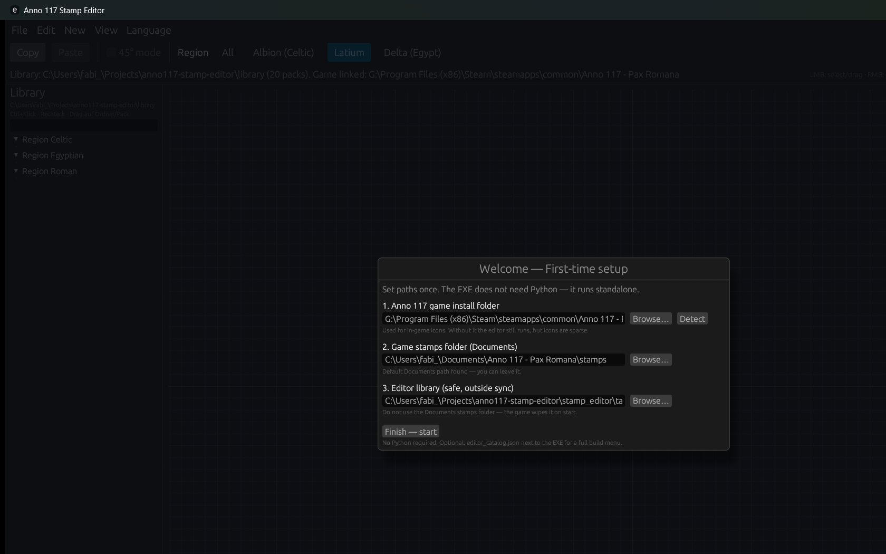

# Anno 117 Stamp Editor

Community tool (Rust / egui) to **open, edit, and save** Anno 117 stamp packs (blueprints).

> **Not an official Ubisoft product.** Anno 117, trademarks, game assets, and game-related content belong to **Ubisoft** / the respective rights holders. The **editor source code** in this repo is **MIT-licensed** (see [`LICENSE`](LICENSE)) and may be used, modified, and shared accordingly. Details: [Legal](#legal--fair-use).

---

## Screenshots

### First-time setup

On first launch (or via **File → First-time setup…**) you set three paths: game install (icons), game stamps folder, and a safe editor library.



### Main window

Library on the left (packs/stamps), stamp canvas in the center, build menu / analysis along the bottom.


### File menu

| Entry | What it does |
|--------|----------------|
| First-time setup… | Set paths again (game, stamps, library) |
| Link Anno game folder… | Install folder for icons |
| Library folder… | Choose the safe editor library |
| Also save into game folder | On each save: copy **that pack** into Documents stamps (default on) |
| Export to game… | One-shot: copy **all** library packs into Documents stamps |
| Import from game | One-shot: copy packs **from** Documents stamps **into** the library |
| Open pack file… / Save | Load / save a pack |
| Reload catalog | Re-read `editor_catalog.json` |


### Why two stamp folders?

Anno keeps live blueprints under something like:

`Documents\Anno 117 - Pax Romana\stamps\`

The game can **wipe or resync** that folder. So the editor uses a **separate library** (your durable copy) and treats Documents as the **in-game drop folder**.

| | Library (editor) | Documents stamps (game) |
|--|------------------|-------------------------|
| Role | Safe working copy | What the game loads |
| Risk | You control it | May be overwritten by the game |
| Auto sync | — | If **Also save into game folder** is on: each save mirrors **the open pack** library → Documents |
| Manual | **Import from game** = Documents → library | **Export to game…** = whole library → Documents |

Nothing watches the folders in the background. Import/Export are for bulk catch-up; day-to-day editing only needs the checkbox + normal Save.

---

## Features

- Load and save stamp packs (JSON + Pipette / FileDB)
- Place, move, rotate, and copy buildings
- Paint roads and aqueducts (including elevated spans over roads)
- Farms / fields (SubTileGrid), coverage, production chains
- Safe library + optional per-save mirror into Documents stamps (plus manual import/export)
- Residence tiers **T1–T4** visible in the editor (note: in-game blueprints often store only the base GUID)

---

## Quick start (release binary)

1. Download the Windows ZIP from [Releases](https://github.com/Fabibassi/anno117-stamp-editor/releases)
2. Run `stamp_editor.exe` — **no Python, no extra runtime** (standalone)
3. On **first launch**, the setup wizard opens:
   - Anno game folder (install with `maindata\ui.rda`) — for icons
   - Game stamps — often `Documents\Anno 117 - Pax Romana\stamps` (auto-detected when present)
   - Editor library — a safe folder **outside** the sync folder
4. Later again: **File → First-time setup…**

Optional for a full build menu: place `editor_catalog.json` next to the EXE (or under `_gamedata\`). The editor still starts without a catalog.

### Missing icons (base game / no DLC)

Icons are **not** shipped with the editor. They are read from your Anno install (`maindata\ui.rda` and patch RDAs). DLC buildings often only have icons if that DLC is installed.

If an icon is missing you may see a **text fallback** on the canvas (name / `GUID …`) instead of a picture. That is **expected**, not a broken install — editing and saving still work. The build menu also hides unresolved DLC stub entries.

Without a linked game folder at all, icons stay sparse (only whatever is already in a local cache).

Whether a stamp **works in-game** without the matching DLC is up to Anno; the editor does not check that.

### Windows SmartScreen (“Windows protected your PC”)

The release EXE is currently **not code-signed**. SmartScreen often warns on new/unsigned community tools.

**To run anyway:**

1. Click **More info**
2. Then **Run anyway**

That is normal for unsigned open-source downloads and is **not** proof of malware. The source is public on GitHub, and you can build it yourself with `cargo build --release`.

**VirusTotal:** Release builds were checked before promotion (0 detections). Current SHA256 is in the [release notes](https://github.com/Fabibassi/anno117-stamp-editor/releases).

---

## Build from source

Requirements: [Rust](https://rustup.rs/) (stable), Windows.

```powershell
cd stamp_editor
cargo run --release
```

Open a pack directly:

```powershell
cargo run --release -- --open "C:\path\to\your\stamp.json"
```

Tests:

```powershell
cargo test --release
```

Fix legacy cistern positions in packs:

```powershell
cargo run --release -- --fix-cisterns "C:\path\to\stamps"
```

For a public release build, set `RUSTFLAGS` with `--remap-path-prefix` for the crate dir, repo root, and Cargo home (so panic paths don’t embed your username), then:

```text
cd stamp_editor
cargo build --release
```

Ship `stamp_editor\target\release\stamp_editor.exe` with `README.md`, `LICENSE`, and `CHANGELOG.md`.

### Catalog & icons (local)

Derived game data does **not** belong on GitHub (`_gamedata/` is ignored).

```powershell
# Example — adjust paths to your install
python _tools\rebuild_editor_catalog.py
```

Game stamps are typically under:

`Documents\Anno 117 - Pax Romana\stamps\`

---

## Controls (short)

| Action | Input |
|--------|--------|
| Library | Left panel; save can optionally mirror to the game |
| Pan | Middle mouse / RMB on empty space |
| Zoom | Scroll |
| Place | Pick a building → LMB |
| Move | LMB drag |
| Roads / aqueduct | Road tool / aqueduct brush |
| Land / marsh | **V** (where supported, e.g. warehouses) |

More detail: [`stamp_editor/README.md`](stamp_editor/README.md)

---

## Residence tiers

Anno 117 often does **not** distinguish upgrade tiers in blueprint files — many stamps only store the T1 GUID (e.g. Liberti). The editor can set and show T1–T4; stamps imported from the game are frequently all T1.

---

## About AI-assisted coding

Large parts of this project were built **with AI help** (Cursor / coding assistants) under human direction: set goals, review, reject, approve.

### Please don’t start drama over “AI code”

- This is a **hobby / community tool**, not a job contest.
- **Nobody loses anything** because AI helped write it — and **nobody “takes” anything** from you. You only get a tool that did not exist before.
- If you dislike the approach: fork it, ignore it, or write your own editor. All fine.
- Feedback on **bugs and UX** is welcome. Moral outrage about *how* the code was written helps nobody.

Short version: code is code. Useful or not is decided by use, not by the keyboard story.

---

## Legal / fair use

Two separate things:

1. **Game connection (Anno 117)** — All rights to *Anno 117 – Pax Romana*, related trademarks, logos, textures, audio, text, GUIDs/game data, and similar content belong to **Ubisoft** / the respective rights holders. This project claims **no** ownership of those and is **not** an official Ubisoft product.
2. **This software (Stamp Editor)** — Source and binaries in this repo belong to the project author and are under the **[MIT License](LICENSE)**: use, modify, fork, and redistribute are allowed if the license notice is preserved. That covers **only** the editor — not game assets.

Also:

- This repo contains **no** unpacked UI textures, no `assets.xml`, and no derived catalog JSONs (`_gamedata/` stays local).
- Use the editor only with data from **your** legal game install.
- Screenshots show the editor UI; any visible game icons/assets remain Ubisoft’s IP.

---

## Contributing

Issues and PRs welcome — bugs, ideas, fixes. See also the project/AI stance issue in the repo.

Changelog: [`CHANGELOG.md`](CHANGELOG.md)
